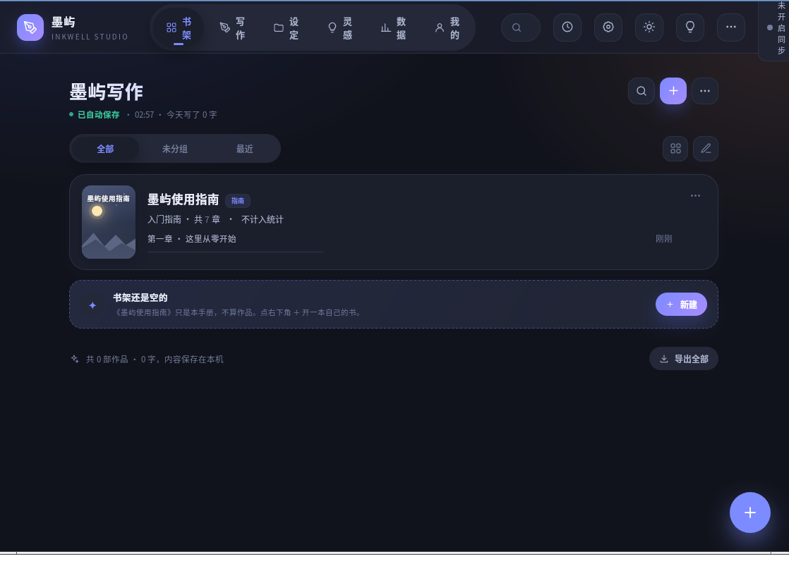

<div align="center">


# 墨屿写作 · INKWELL STUDIO

**一屿墨水，把写作放回安静的地方。**
单文件写作台，打包成 Windows / macOS / Android / iOS 原生应用，内置坚果云同步。

[](#下载)
[](#下载)
[](#下载)
[](#ios)
[](https://tauri.app)
[](LICENSE)

</div>




## 内容热更新（不用重新打包）

墨屿现在支持**换 HTML 不用重装**：

1. 你发来新版本的 `index.html`，我把它放进仓库的 `web/index.html` 并 push；
2. 应用下次打开时会自动检查（优先 jsDelivr，走 GitHub raw 兜底），发现新版就存到本地缓存，并提示「已取到新版本，下次打开生效」；
3. 再下一次启动，直接从缓存渲染新页面，图标、原生能力不变。

为了不白屏，缓存版替换前有 2.6 秒自愈检查：若新文档没解析出内容，自动丢弃缓存回到内置版。断网时永远用本地缓存或内置版，不影响使用。

涉及原生能力的改动（图标、权限、返回键逻辑）仍需重新打包安装，纯内容与交互改动走热更新即可。

## 签名与自动构建

**安卓签名是固定的**：私钥保存在仓库 Secret（`ANDROID_KEYSTORE_BASE64` / `ANDROID_KS_PASS` / `ANDROID_KEY_PASS`），CI 每次都解码同一把钥匙签名。证书指纹：

```
SHA-256: 68:F3:B4:02:12:CC:C9:94:5F:FF:11:01:FA:E6:22:07:91:4C:97:23:6C:E0:AB:94:A6:E1:BF:24:96:7F:FA:10
```

所以新版本可以直接覆盖安装，不用卸载旧版。

**自动触发**：推送到 `main` 且改动了 `web/`、`src-tauri/`、`resources/` 或安卓 workflow 时，安卓和桌面会自动开始构建，不用手动点。

**一键构建全部平台**（含 macOS 与 iOS）：

```bash
GH_TOKEN=ghp_xxx ./scripts/build-all.sh          # 全部
GH_TOKEN=ghp_xxx ./scripts/build-all.sh android  # 只安卓
```

脚本会依次触发 workflow、轮询到结束、把产物下载到 `dist/`。macOS 与 iOS 走 macOS runner，按需触发以免消耗额度。

## 这是什么

墨屿写作原本是一个 370KB 的单文件 HTML：一个能在浏览器里直接打开、双击就能写的写作台。

这个仓库把它做成了**可以安装的原生应用**：不改变原有界面代码，而是在外面套一层 Tauri 2 的壳，再用 Rust 把浏览器做不到的事补上——读写本地文件、越过 CORS 直连坚果云 WebDAV、多端共享同一份文稿。

相比 Electron 版本，安装包从 104MB 降到 4~24MB，冷启动几乎瞬时，内存占用也低一个数量级。

## 下载

| 平台 | 文件 | 说明 |
| --- | --- | --- |
| Windows | `Inkwell_1.0.0_x64-setup.exe` / `.msi` | 双击安装；未签名，SmartScreen 提示时选「更多信息 → 仍要运行」 |
| macOS | `Inkwell_1.0.0_universal.dmg` | Intel 与 Apple Silicon 通用；首次打开请右键 →「打开」 |
| Android | `Inkwell-1.0.0.apk` | release 包 + 自签名，允许「未知来源」即可安装 |
| iOS | `Inkwell-1.0.0-unsigned.ipa` | 未签名 ipa，用 Sideloadly / AltStore 配自己的 Apple ID 签一次即可装 |

所有产物在 [Releases](../../releases) 页面，也在 Actions 的 Artifacts 里。

> 应用均未做代码签名与公证（个人项目，无 Apple / 微软开发者账号）。这不影响功能，只是首次启动会被系统多问一句。

## 功能

墨屿写作本体自带的能力，桌面与手机端一致：

- **书架**：作品、章节、分卷、指南书三态管理，支持「全部 / 未分组 / 最近」
- **写作页**：宋体中文排版、稿纸模式、字数统计、自动保存、专注模式（隐藏所有界面装饰）
- **数据**：写作日历与字数统计视图、全库导出
- **我的**：主题（日间 / 夜间 / 纸张）、字号、行距、编辑区宽度
- **灵感**：随手记的碎片，可提升为正式作品

外壳额外补上的：

- **本地同步文件夹**：把作品库指向坚果云客户端的本地目录，md / JSON 直接落盘
- **WebDAV 直连**：Rust 侧发起请求，绕开浏览器 CORS，账号密码只存在本地
- **原生文件对话框**：导出、导入走系统选择器，不再受浏览器沙箱限制
- **移动端安全区适配**：状态栏、刘海、手势条不再遮挡内容

## 坚果云同步

设置 → 同步，两条路线二选一，随时可切换。

### 路线 A：本地同步文件夹（推荐，最稳）

1. 电脑装坚果云客户端，任意同步文件夹保持「同步中」
2. 应用里选择这个文件夹下的 `墨屿/` 目录
3. 应用直接读写本地文件，坚果云客户端负责上传下载

优点：不依赖网络 API、大文件无限制、坚果云换密码也不影响。
缺点：手机端没有「本地同步文件夹」概念，此路线仅桌面可用。

### 路线 B：WebDAV 直连

1. 浏览器登录坚果云 → 设置 → 安全选项 → **添加应用密码**（**不能用登录密码**）
2. 应用内填：服务器 `https://dav.jianguoyun.com/dav/`、邮箱、应用密码
3. 远程路径默认 `墨屿/inkwell-sync.json`，可自定义

浏览器里做这件事一定会被 CORS 拦掉——这是浏览器安全模型决定的，不是坚果云的问题。墨屿写作把请求交给 Rust 侧的 `proxy_http` 命令，由原生代码带 Basic 认证头直接发出去，把响应回填成一个 `Response` 对象还给前端，所以前端那套同步逻辑一行没改就能跑通。

> 应用密码只保存在本机，不上传、不写进仓库。

## iOS

这里提供的 ipa 是**未签名**的：iOS 必须用 Apple ID 签名才能装进真机，免费证书 7 天失效，我无法替你签。下载 `Inkwell-1.0.0-unsigned.ipa` 后，拖进 Sideloadly / AltStore / SideStore，输入自己的 Apple ID 签一次，就能装到手机上。为什么不是「已签名 ipa」：签名需要你的开发者证书私钥，我这里没有，也拿不到。

三条可行路径：

```bash
# 1. 有 Mac：本地构建
git clone https://github.com/david1a21/moyu-writer.git
cd moyu-writer
npm install -D @tauri-apps/cli@latest
npx tauri ios init
npx tauri ios build          # 需要 Xcode 与已登录的 Apple ID
```

```text
# 2. 没有 Mac：GitHub Actions 出未签名 .app，再用 sideload 工具装
Actions → Build iOS App → Run workflow → 下载 writer-ios-unsigned（标准 ipa）
用 AltStore / SideStore / Sideloadly 配合你自己的 Apple ID 签名安装（ipa 已按标准 Payload 结构打包）
```

```text
# 3. 只想要源码：src-tauri/gen/apple 由 tauri ios init 生成，不入库
```

## 本地开发

```bash
git clone https://github.com/david1a21/moyu-writer.git
cd moyu-writer

# 前置：Rust、Node 18+；Linux 还需 libwebkit2gtk-4.1-dev 等
npm install -D @tauri-apps/cli@latest

npx tauri dev      # 开发模式
npx tauri build    # 出安装包
```

工程结构：

```
web/                     界面（原单文件 HTML + 两个注入脚本）
├── index.html
├── native-fetch-shim.js 把 window.fetch 劫持到 Rust，绕开 CORS
└── sync-bridge.js       三端统一的同步层
src-tauri/
├── src/lib.rs           save_local / read_local / list_local
│                        dav_get / dav_put / dav_list / dav_request
│                        proxy_http（任意方法 + 任意头的通用代理）
├── tauri.conf.json      产品名、标识、窗口
└── icons/               由 tauri icon 从一张 1024 PNG 生成的全套尺寸
resources/patch-android.py   CI 里关闭 Android edge-to-edge，修状态栏遮挡
.github/workflows/       四条流水线
```

## 构建流水线

| Workflow | 触发 | 产出 |
| --- | --- | --- |
| `build.yml` | push / 手动 | Windows exe + msi、Linux AppImage + deb |
| `build-macos.yml` | 手动 | universal dmg |
| `build-android.yml` | 手动 | 自签名 APK |
| `build-ios.yml` | 手动 | 未签名 .app（zip） |

**关于「每次都要重跑 Actions 吗」——不需要。**

- 产物是永久的：一次构建出来的安装包留在 Actions Artifacts（30 天）和 Releases（永久），随时下载，不会因为不重跑而消失
- 平时改代码 → push 到 main，Windows / Linux 自动出包，你不用管
- macOS / Android / iOS 是手动触发，只有**改了代码或想更新版本**时才需要点一次
- 想发新版：改 `tauri.conf.json` 的 `version`，打 tag，跑一遍，传 Release

代价只有一个：GitHub 免费额度的 macOS runner 排队不稳，iOS 那种十几分钟的构建偶尔会在排队阶段被平台取消，重跑一次通常就好。

## 为什么是 Tauri 而不是 Electron

|  | Electron | Tauri 2 |
| --- | --- | --- |
| 安装包 | 104MB 起 | 4MB（macOS dmg）/ 24MB（APK） |
| 运行时 | 自带 Chromium | 系统 WebView |
| 内存 | 高 | 低 |
| 原生能力 | Node.js | Rust 命令，编译期绑定 |

代价是 Rust 门槛和平台工具链，但换来的是「一个单文件 HTML 变成一个 4MB 的 dmg」。

## 许可

MIT。界面与写作功能归原作者；外壳、同步桥与流水线随本仓库开源。

<div align="center">
<sub>墨屿 · 写下去就好</sub>
</div>
